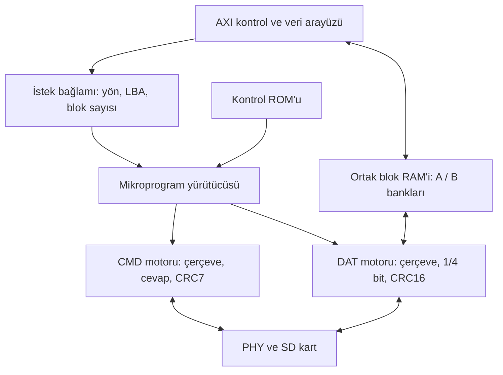

# SD host v2 mimari önerisi

Bu belge ölçülmüş bir uygulama sonucu değil, mevcut tasarıma alternatif bir mimari önerisidir. Öncelik FPGA LUT/register kullanımını azaltmak olarak kabul edildi. Mevcut RTL değiştirilmiyor.

## Ana karar

Denenecek mimari: **mikroprogramla yönetilen işlem motoru + bağımsız CMD/DAT motorları + ortak blok belleği**.

İki temel değişiklik birlikte değerlendirilecek:

1. Başlatma, blok sıralama ve toparlanma politikasını paylaşılan bir mikroprogram yürütücüsüne taşımak.
2. İki kelime FIFO'su ve commit/rewind işaretçileri yerine, sahipliği blok bazında devredilen ortak RAM bankları kullanmak.

Mikroprogram ve blok bankı teknikleri bilinen tasarım yöntemleridir. Buradaki öneri bu projede kontrol mantığı ile belleğin paylaşım biçimini kökten değiştirmektir; yeni veya benzersiz bir buluş iddiası yoktur.

## Kontrol politikası ROM'da, bit zamanlaması donanımda

Şu an sistem fazı, init adımı, komut fazı, blok fazı ve toparlanma nedeni farklı yerlerde tutuluyor. Hepsi gereksiz değil; özellikle CMD ve DAT motorları örtüşen zamanlarda çalışabilmeli. Ortaklaştırılacak olan, motorların üzerinde hangi işlemin sırada olduğuna karar veren politika.

İlk yürütücü taslağı:

- Küçük bir mikroprogram sayacı ve komut çözücü.
- Çalışma bağlamı: geçerli LBA, kalan blok, yön ve yeniden deneme bütçeleri.
- Motor olaylarını kaçırmamak için tutulan tamamlanma/hata bitleri.
- Komut argümanını sabit, LBA, RCA veya blok sayısından seçen yol.
- Uzun süreli beklemeler için deadline kaynağı; aynı anda gereken süreler bağımsız deadline kayıtlarıyla izlenir.

Başlangıç kontrol belleği adayı 128 × 32 bittir, yani 512 baytlık mantıksal ROM. Gerçek programın bu boyuta sığdığı ve ROM'un Gowin'de blok RAM'e eşlendiği sentezle doğrulanmalı. LUT ROM'a dönüşürse beklenen alan kazancı kaybolabilir. Genel amaçlı işlemci, stack veya geniş bir komut kümesi gerekmiyor.

Örnek mikroişlemler: komut gönder, olayı bekle, koşullu dallan, çerçeve hazırla, bankı yayımla, aynı bankı yeniden dene, bağlamı ilerlet, işlemi bitir. Init dizisi ve CMD12/CMD13 toparlanması aynı yürütücünün farklı program girişleri olur.

DAT motoru bit veya kelime başına mikrokomut yürütmez. Bir kez hazırlanınca çerçeveyi bağımsız akıtır. Bir sonraki çerçeve bağlamı mevcut çerçeve sürerken hazırlanır; son blok, CRC hatası ve tampon kredisi sınırları motorun yerel korumalarıyla uygulanır. Böylece ROM okuma/dallanma gecikmesi blok başlangıcını kaçırmamalı.

CMD motoru da bağımsız kalır. Veri akışı devam ederken durdurma komutunun gönderilmesi ve komut cevabıyla DAT başlangıcının örtüşmesi desteklenmelidir. İki hattı tek meşgul motor haline getirmek önerilmiyor.

Resetin güvenli bırakılması, kart algılama ve saat açma/kapama için gerekli küçük gözetim mantığı korunur. Saat kapalıyken mikroprogramın yürüyerek kendi saatini açacağı varsayılmaz.

## Bellekte kelime işaretçileri yerine blok sahipliği

İlk veri belleği adayı, aynı fiziksel RAM içinde iki adet 512 baytlık banktır. Bank sayısı parametrik tutulabilir. İki bank seçimi, mevcut 3 KiB tamponu 1 KiB'a düşürür; aynı tampon kapasitesiyle yapılan karşılaştırma ayrıca raporlanmalı. Kapasiteyi azaltmaktan gelen kazanım mimari kazanımla karıştırılmamalı.

| İşlem | Bankın yaşam döngüsü |
|---|---|
| Karttan okuma | SD tarafı bankı alır → doldurur → CRC doğruysa AXI'ye yayımlar → AXI boşaltıp iade eder |
| Karta yazma | AXI bankı doldurur → SD tarafına yayımlar → SD aktarır → başarılı kabulden sonra bank serbest kalır |
| CRC retry | Bank sahipliği korunur; yerel kelime indeksi başa alınır |

Bu yaklaşımda CRC bozuk bir okuma bankı AXI'ye hiç yayımlanmaz. Yazma yeniden denenirken aynı bankın verisi korunur. Mevcut iki FIFO'nun bağımsız spekülatif/commit işaretçilerinin yerini bank sahipliği, yayımlama ve iade olayları alır. Alan kazancı ölçülmeden varsayılmamalıdır.

RAM portlarının saatleri sabit kalır: bir port AXI saatinde, diğeri SD saatinde. Okuma/yazma yönü veri ve write-enable seçimini değiştirir; saatler mux'lanmaz. Her iki portun da kendi saatinde okuma/yazma yapabildiği uygun gerçek çift port RAM eşlemesi gerekir.

CDC tamamen ortadan kalkmaz. Bank yayımlama/iade olayları senkronize edilir; ilgili çok bitli bilgi devir boyunca sabit tutulur. İki alan aynı bankı aynı anda değiştiremez. Reset, iptal ve yön değişiminde eski bank olaylarının yeni isteğe karışmaması tasarlanmalıdır.

Paylaşılan bellek, aynı anda okuma çıktısını tutup gelecekteki yazmanın verisini önceden kabul etme esnekliğini sınırlar. Yön değişimi ve yazma verisini START öncesinde yükleyen sürücülerin davranışı açıkça ele alınmalı; iki bankın dolması nedeniyle sürücü ile donanım birbirini beklememeli.

## Mevcut katmanlardan ne değişir?

| Mevcut bölüm | V2'de karşılığı |
|---|---|
| L3 blok FSM'si | Mikroprogram ve ortak işlem bağlamı |
| L2 init ve protokol politikası | Mikroprogramın init/komut programları |
| L2 CMD bit motoru | Bağımsız donanım motoru olarak korunur |
| L1 DAT motoru | Açık kabul/iptal sözleşmeli çerçeve motoru |
| İki async payload FIFO'su | Ortak blok RAM'i ve bank sahipliği |
| Sistem faz yönetimi | Motor gözetimi ve ortak işlemin durumu; fiziksel reset/clock gözetimi ayrıca korunur |

`doc/checklist.md` içinde beş katmanlı hiyerarşi ve donanımda init gereksinimleri bulunuyor. Bu öneri init'i donanımda tutar. Ortak yürütücünün hangi modülde bulunacağı, özgün R-ARCH-1 görev dağılımıyla ayrıca eşleştirilmeli; modül adlarını korumak tek başına mimari uyumluluk kanıtı değildir.

## Başarı ölçütü ve deneme sırası

Önerilen kabul eşiği, aynı işlevler ve aynı tampon kapasitesiyle bütün çekirdekte en az %25 daha az LUT'tur. Bu bir hedeftir, ölçülmüş kazanç değildir. Register, ALU ve BSRAM değişimleri de ayrı raporlanmalıdır. 4-bit/50 MHz hedefi, donanım init, retry, zaman aşımları, istatistikler ve hata sonrası yeniden kullanılabilirlik korunmalıdır.

İlk karşılaştırma yalnızca bellek mimarisini değiştirmeli; mevcut CMD/DAT motorları korunarak bank devri, AXI backpressure ve retry doğrulanmalı. Ardından ortak mikroprogram kontrolü denenmeli. Her iki aşama ayrı sentezlenmeli; birleşik sonuç da ölçülmeli. Böylece hangi tercihin maliyet getirdiği veya kazanç sağladığı görülebilir.

Kaynak kazanımı büyük olmazsa bu mimari daha kısa RTL ürettiği için benimsenmemeli. ROM, olay kayıtları, yeni seçim yolları ve CDC de maliyetlidir.

## Karşılaştırma kaynakları

- [LiteSDCard'da komut cevabı sürerken okuma verisini alma düzeltmesi](https://github.com/enjoy-digital/litesdcard/commit/227d61b): CMD ve DAT ilerleyişini tek sıralı meşgul motoruna indirmenin neden doğru bir varsayım olmadığını gösteren somut örnek.
- [LiteX SD kart sürücüsü](https://github.com/enjoy-digital/litex/blob/master/litex/soc/software/liblitesdcard/sdcard.c): Başlatma politikasını yazılıma taşıma alternatifi için karşılaştırma. Burada önerilen v2, projenin donanım init gereksinimi nedeniyle bunu varsaymıyor.

Bu kaynaklardan kod alınmadı. Mikroprogram ve ortak blok RAM'i önerisinin kaynak/timing sonuçları henüz ölçülmedi.
